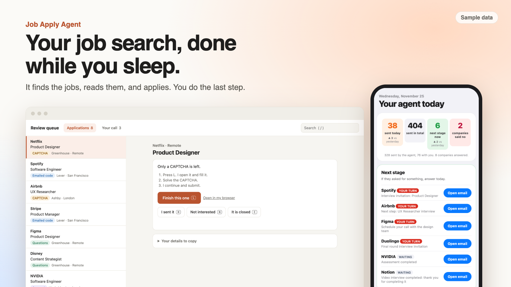
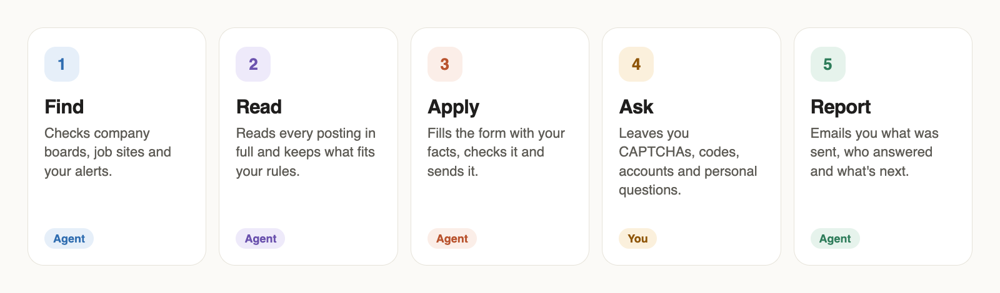
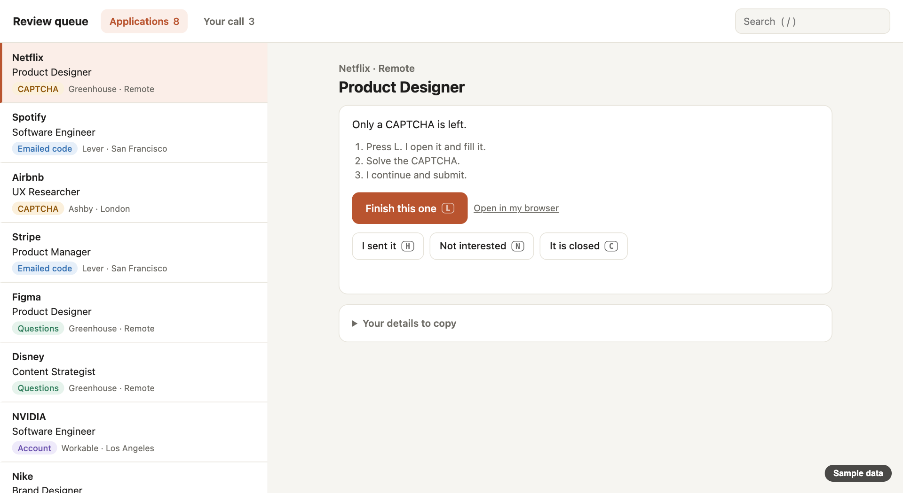
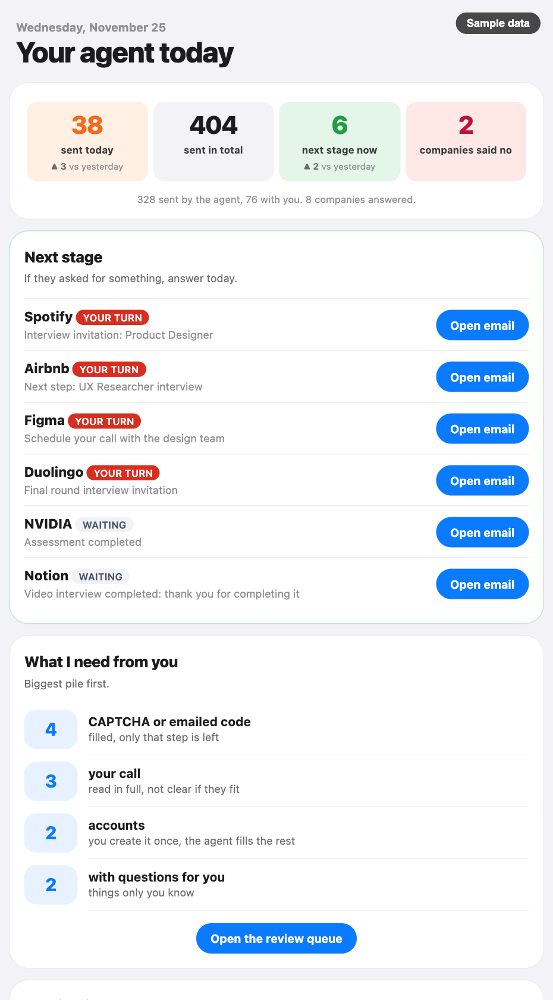

<div align="center">



# Job Apply Agent

**Wake up to applications already sent.** A personal agent that finds jobs you'd want, reads every posting, fills the forms with your real information, and emails you the results.

Free · Open source · Runs on your computer

[](https://github.com/jfridzon/Job-Apply-Agent/actions/workflows/ci.yml)  [](LICENSE)

[Get started](#get-started) · [How it works](#how-it-works) · [What you get](#what-you-get) · [Questions](#questions)

</div>

Applying for jobs is mostly repetition: the same searches, the same forms, the same questions. This agent takes the repetition and leaves you the parts that need you.

## How it works



You choose the roles, places, companies and pay. The agent decides from the **full posting**, not the title. If it isn't sure a job fits, it asks you instead of applying.

## What you get

### One list of what needs you



Some steps only you can do: a CAPTCHA, a code from your email, a new account. They're in one list, with the best use of your time first. Press **L**, do your one step, and the agent finishes and sends it.

### A daily email

<table><tr><td width="46%"></td><td valign="top">

**Know where you stand in a minute.**

- Who wants to talk to you
- What was sent today
- What needs you, by type
- How many postings it read, and how many fit
- Who answered, and what they said

It's sent from your own email, only to you.

</td></tr></table>

### And the rest

| | |
|---|---|
| **Searches widely** | Greenhouse, Lever, Ashby, Workable, Recruitee, SmartRecruiters and Workday boards, public job feeds, sites you sign in to, and your job alerts |
| **Never makes things up** | Every answer comes from what you told it. Missing something? It asks |
| **Doesn't apply twice** | It checks its history and your confirmation emails before sending |
| **The right resume** | Keep several versions and it picks one for each role |
| **Works at night** | You set the hours, and you can pause it |
| **Light on AI usage** | Plain code does the searching and the forms. AI is only used for judgment |
| **Private** | No server, no account, no tracking. Your files stay on your computer |

## Get started

You need a computer, Google Chrome, [Node.js](https://nodejs.org) and an AI assistant that can run commands, such as Claude Code, Codex or Gemini CLI.

**Paste this into your assistant:**

```text
Clone https://github.com/jfridzon/Job-Apply-Agent, read AGENTS.md and set it up for me.
```

It will:

1. Show you a demo.
2. Read your resume and ask what you're looking for.
3. Have you sign in to the job sites you use.
4. Show you the jobs it would pick, and adjust until you agree.
5. Do a practice run that sends nothing.
6. Start applying, only after you say yes.

**Just want to look?**

```bash
git clone https://github.com/jfridzon/Job-Apply-Agent.git
cd Job-Apply-Agent
npm install
npm run demo
```

## Questions

**Will it apply to everything?** No. It skips what doesn't fit and tells you why.

**Can it lie for me?** No. It won't invent experience or claim a work status you don't have.

**Does it solve CAPTCHAs or type my passwords?** No. Those are yours.

**Who sees my information?** The employers you apply to, your AI provider, and your own email. [More on privacy and safety](docs/SAFETY.md).

**Does it use LinkedIn or Indeed?** It reads the job alerts they email you and applies on the employer's own site. It doesn't automate those sites.

**Does it work in other languages?** English by default, Spanish included. Your assistant can translate it to others.

**Do I need to know how to code?** No. Your assistant does the setup. Expect to watch the first few applications with it.

**Are the numbers in the pictures real?** No, they're sample data. The companies shown aren't affiliated with this project.

## For developers

Plain Node, one dependency, no build step. State lives in append-only ledgers, so a crash never loses progress. Tests run the form filler, site sweeps and the waiting step in a real browser. Job portals change often, so contributions are welcome: see [CONTRIBUTING.md](CONTRIBUTING.md).

| | |
|---|---|
| [AGENTS.md](AGENTS.md) | What your assistant follows |
| [Interview](docs/INTERVIEW.md) | What it will ask you |
| [Configuration](docs/CONFIGURATION.md) | Every setting |
| [Sources](docs/SOURCES.md) | Where it looks for jobs |
| [Scheduling](docs/SCHEDULING.md) | Nightly runs, email and pause |
| [Architecture](docs/ARCHITECTURE.md) | How and why it's built this way |

MIT License
