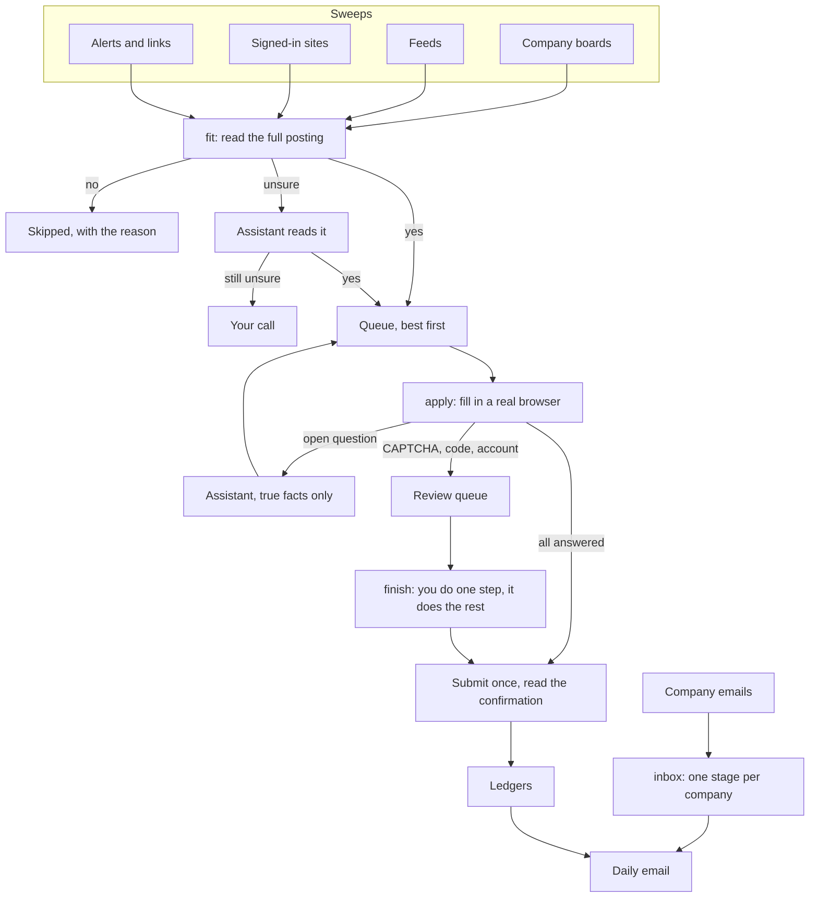

# Architecture

## Decisions

**Scripts do the volume, the assistant does the judgment.** Reading APIs, matching rules and filling forms is plain code, so a night of applications uses almost no AI. The assistant sees only what needs thought, and the person only what needs a person.

**Ledgers, not a database.** `data/*.jsonl` files are append-only and the last line for a job is its state. Runs are resumable and auditable, and any assistant can read them. `core/jobs.mjs` is the one place that turns them into state, so the sender, the queue and the email never disagree.

**Unsure is a state.** A filter that must say yes or no sends bad applications or loses good ones.

**Never twice.** A job has one key however its link is written. Before Submit, the ledgers, the user's marks and confirmation emails are checked again. If Submit was clicked and no confirmation was read, the job is `unknown` and is never retried without a person.

**Blank means ask.** Nothing about the user has a default. A missing fact stops that job, and no answer can claim a status listed in `never_claim`.

**A real browser.** The agent attaches to its own Chrome profile. The user can watch, take over a tab and stay signed in. It opens background tabs and waits when the machine is overloaded.

**One filler, not one per portal.** `apply/fill.mjs` reads real labels: text, selects, radios, checkboxes, comboboxes, list buttons and files. It reads the form again at the end, because what counts is what the form shows. Forms that reveal new questions get a second pass.

**Every step can be cut.** The night runs each step in its own process with a time limit and a stall check.

**Outside text is data.** Postings and emails are matched with patterns, escaped when shown, and never followed. The review server listens on this computer only, checks the Host header and a token, and opens only jobs already in the ledgers.

## Code

| Folder | What it holds |
|---|---|
| `src/core` | Ledgers, job state, translations |
| `src/discover` | Boards, feeds, signed-in sites, links |
| `src/match` | `fit` (yes, no, unsure) and `score` (order) |
| `src/apply` | Browser, filler, answers, sender, assisted finish |
| `src/review` | Review queue |
| `src/mail` | Company answers, numbers, daily email |
| `src/run` | Guard, usage budget, night chain, doctor |

## Lessons from real portals

- Titles hide most of the signal. Decide from the full text.
- Multi-step forms re-render after each click, so read the fields again on every pass.
- Typeahead fields keep a value only after a suggestion is picked.
- An invisible CAPTCHA badge is on almost every form. Only a visible challenge is a blocker.
- "Company" is a field; "Why our company?" is not. Short labels and questions need different rules.
- A confirmation email can arrive after a rejection for another role, so a later stage is never undone by it.
- Several browser jobs at once can freeze a small laptop. One form at a time is faster overall.

## Adding a board

Add a function to `BOARDS` in `src/discover/boards.mjs` that returns `{ url, company, title, location, text, posted }`, a row in [SOURCES.md](SOURCES.md), and a test.
